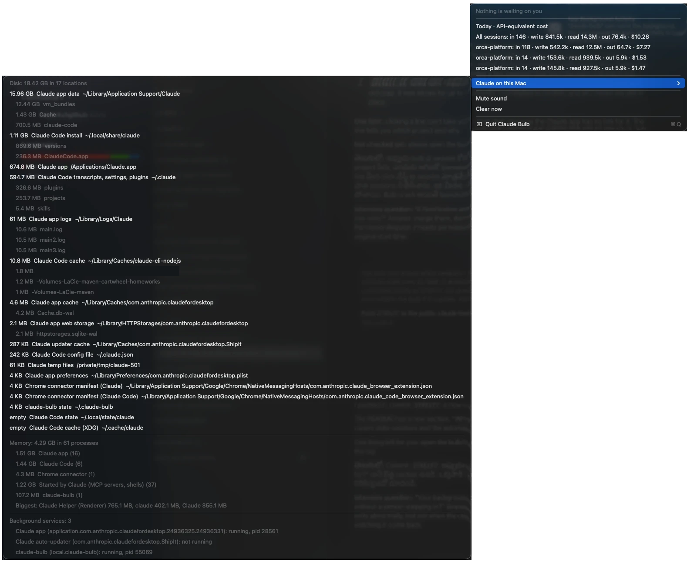

# claude-bulb 💡

A tiny macOS menu bar light for [Claude Code](https://code.claude.com).
When Claude is **waiting for you** (a permission prompt, a question, or a finished turn),
the bulb next to your clock **blinks red** and plays a sound every 30 seconds.
When you answer, it goes calm.


<sub>The bulb's states, drawn with the same SF Symbols and colours the app uses (an illustration, not a screen recording).</sub>

No dependencies beyond Apple's own tools. About 150 lines of Swift, Bash and Python.

```
 calm:     💡 (outline, follows light/dark menu bar)
 waiting:  🔴 blinking red bulb + "Glass" sound every 30 s
```

## Requirements

- macOS 12 (Monterey) or newer, Apple Silicon or Intel
- Apple Command Line Tools (gives `swiftc` and `python3`):
  ```bash
  xcode-select --install
  ```
- Claude Code (CLI or desktop app)

## Install

```bash
git clone https://github.com/swathikchgithub/claude-bulb.git ~/tools/claude-bulb
~/tools/claude-bulb/install.sh
```

You can clone it anywhere; the hooks point at wherever the repo lives.
If you move the folder later, run `install.sh` again.

`install.sh` does four things:

1. Builds `bin/claude-bulb` from `Sources/` with `swiftc`.
2. Runs `test.sh`.
3. Installs a LaunchAgent (`~/Library/LaunchAgents/local.claude-bulb.plist`) so the bulb
   starts now and at every login.
4. Adds the hooks to `~/.claude/settings.json` (global, all projects).
   A timestamped backup of that file is written first. Your other hooks are left alone.

Then **restart any Claude Code sessions** that were already open, so they load the hooks.

## Use

Nothing to do. Work with Claude as usual. The bulb lights up when Claude needs you.

Click the bulb for its menu:



<sub>A real screenshot of the menu. One cache folder name that contained a username is blanked out.</sub>


| Menu item | What it does |
|---|---|
| Waiting on you | One line per session the bulb is lit for: project, reason, how long. Click a line to clear just that session |
| Today · API-equivalent cost | Grey lines: tokens and cost for all sessions today, then the 5 costliest sessions |
| Claude on this Mac ▸ | Disk, memory and background services used by Claude and Claude Code. Click a location to show it in Finder |
| Mute sound | Keep blinking, stop the sound (until the app restarts) |
| Clear now | Turn the bulb off for all sessions |
| Quit Claude Bulb | Stop the app until next login |

### When does it light up?

| Claude Code hook | Bulb |
|---|---|
| `PermissionRequest` (Claude asks to use a tool) | red |
| `Notification`: `permission_prompt`, `idle_prompt`, `elicitation_dialog` | red |
| `Stop` (Claude finished its turn) | red |
| `UserPromptSubmit`, `PostToolUse`, `PostToolUseFailure`, `SessionEnd` | calm |

Each Claude session is tracked separately, so with two sessions open,
answering one does not hide the other.

## Which session is the bulb lit for?

The top of the menu lists them, or run:

```bash
~/tools/claude-bulb/bin/claude-bulb list
```

```text
Waiting on you (2):
  orca-platform — needs permission: Bash · 3 min ago
      "Claude needs your permission to use Bash"
      session 83148641-3e0b-43f3-b3ef-18d971b94d5b
  evalify — finished its turn · 12 min ago
      "Tests pass now."
      session 1d0ce06a-1fcb-44ab-af26-e74088766e4a
```

| Reason | Comes from |
|---|---|
| needs permission: *tool* | `PermissionRequest` |
| asked you a question | `PermissionRequest` for `AskUserQuestion` |
| finished its turn (plus the first line of Claude's last reply) | `Stop` |
| waiting for your reply, an MCP server asks for input | `Notification` |

**Stale sessions are removed automatically:** a session that no hook has touched for 12 hours, or
whose transcript file is gone. That covers sessions that ended without `SessionEnd`
(app closed, crash). The line cannot open that chat for you; it tells you which project and why.

## Token use and cost

Open the bulb's menu to see today's tokens and cost, or run:

```bash
~/tools/claude-bulb/bin/claude-bulb usage
```

```text
Today, API-equivalent cost (not what a subscription bills):
  orca-platform: in 58 · write 159.1k · read 4.8M · out 29.7k · $2.84
  Total: in 134 · write 390.1k · read 8.9M · out 51.4k · $5.93
```

- **in**: input tokens not served from cache. **write**: tokens written to the prompt cache.
  **read**: tokens served from the cache (cheap). **out**: output tokens.
- The numbers come from Claude Code's own transcripts in `~/.claude/projects`. Nothing is sent anywhere.
- **The cost is API-equivalent.** On a Pro or Max subscription you do not pay this; it is what the
  same use would cost on the Claude API. Prices live in [`prices.json`](prices.json), copied from
  [Anthropic's pricing page](https://platform.claude.com/docs/en/about-claude/pricing). Update it when prices change.
- A reply whose model is not in `prices.json`, or that used fast mode, is counted in tokens and
  shown as "unpriced". The cost is never guessed.
- `claude-bulb usage --since 2026-11-01` covers more than one day.

## Claude on this Mac

The **Claude on this Mac** submenu, or this command:

```bash
~/tools/claude-bulb/bin/claude-bulb footprint
```

```text
Disk: 18.41 GB in 17 locations
  15.97 GB  Claude app data  ~/Library/Application Support/Claude
      12.44 GB  vm_bundles
  1.11 GB  Claude Code install  ~/.local/share/claude
  ...
Memory: 2.16 GB in 23 processes
  1.48 GB  Claude app (11)
  397.5 MB  Claude Code (1)
  232 MB  Started by Claude (MCP servers, shells) (8)
  ...
Background services: 3
  Claude auto-updater (com.anthropic.claudefordesktop.ShipIt): not running
  ...
```

- **Disk**: a fixed list of known Claude and Anthropic locations, plus anything named "claude" or
  "anthropic" in the usual app folders. Sizes are space on disk in decimal units, like Finder
  (`du -h` uses 1024, so it shows smaller numbers). It refreshes at most every 10 minutes.
- **Memory**: processes that run from a Claude install, **plus everything they started**. That is how
  MCP servers that only show up as `node` are counted. Shared memory is counted once per process,
  as in Activity Monitor, so the total is slightly high.
- **Background services**: your user's launchd jobs with "claude" or "anthropic" in the label,
  plus plists installed but not loaded.
- **Read-only.** It never deletes or stops anything. Most of the disk use (`vm_bundles`) is the
  Claude app's agent VM image; the app needs it.
- It only sees this Mac, not anything stored in the cloud.

## Try it by hand

```bash
echo '{"session_id":"manual-test"}' | ~/tools/claude-bulb/bin/claude-bulb on
```
```bash
echo '{"session_id":"manual-test"}' | ~/tools/claude-bulb/bin/claude-bulb off
```

## Uninstall

```bash
~/tools/claude-bulb/uninstall.sh
```
```bash
rm -rf ~/tools/claude-bulb
```

`uninstall.sh` stops the app, removes the LaunchAgent, removes only the claude-bulb hooks
from `~/.claude/settings.json` (backup first) and deletes `~/.claude-bulb/`.

## Docs

- [How it works](docs/how-it-works.md): the design, file by file
- [Customize](docs/customize.md): change the sound, interval or triggers
- [Troubleshooting](docs/troubleshooting.md)

## License

[MIT](LICENSE)
